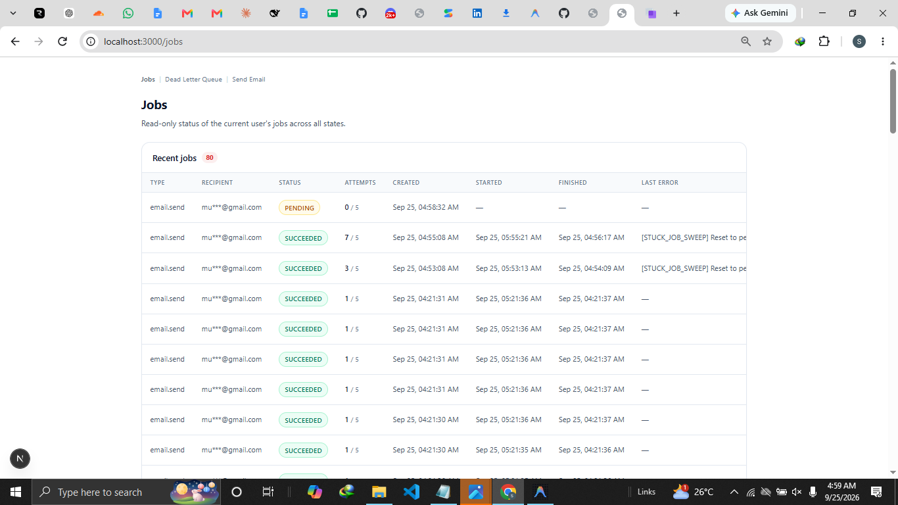
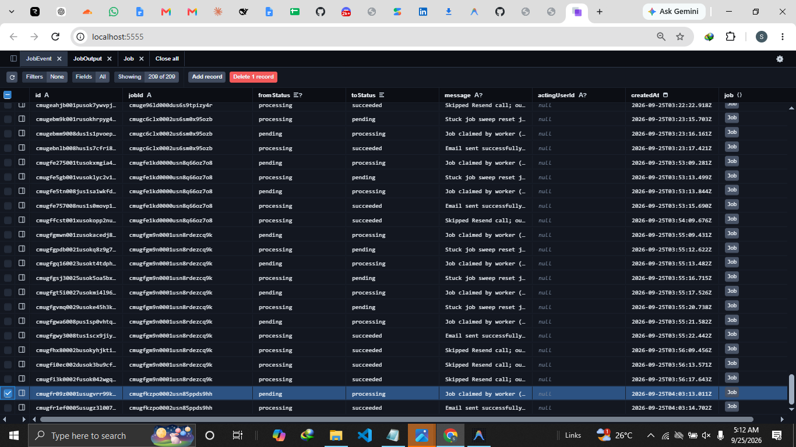
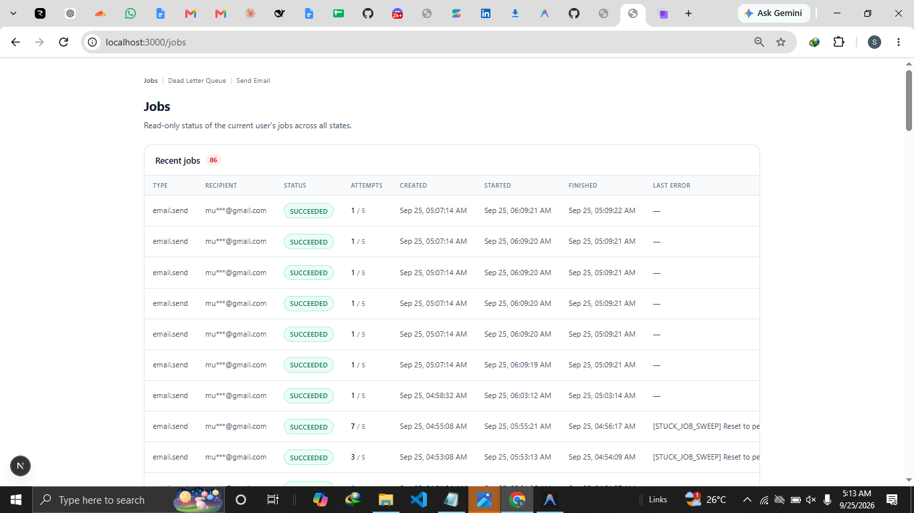
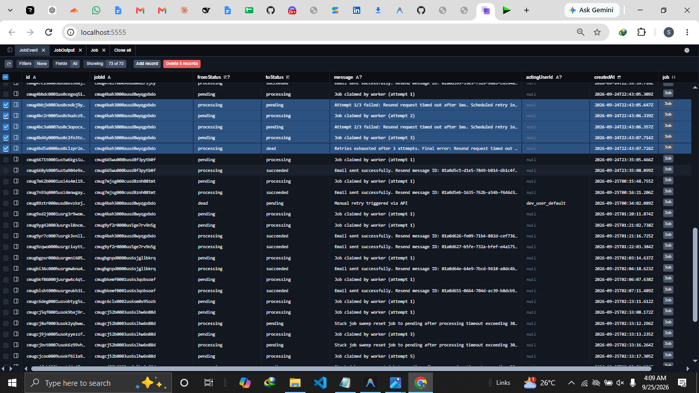
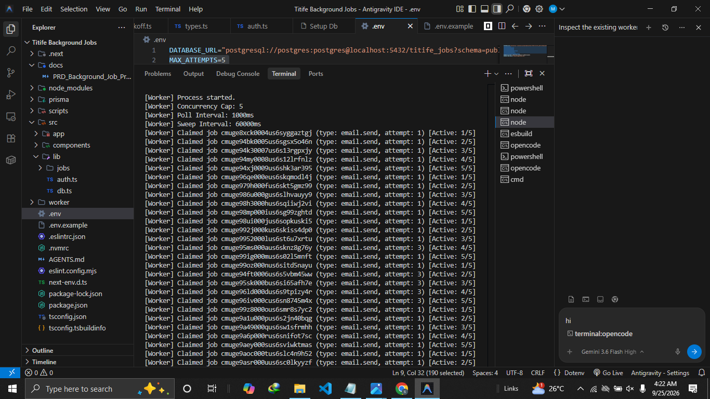
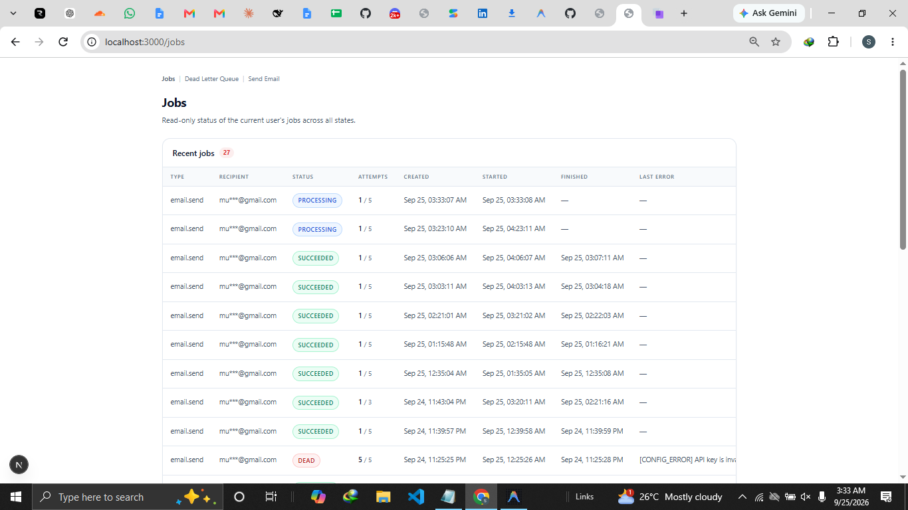
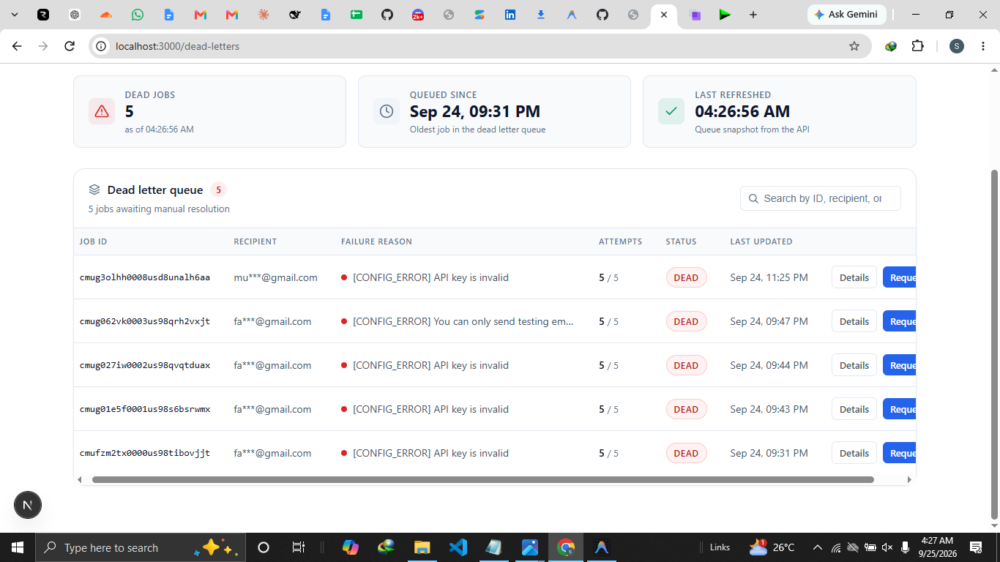
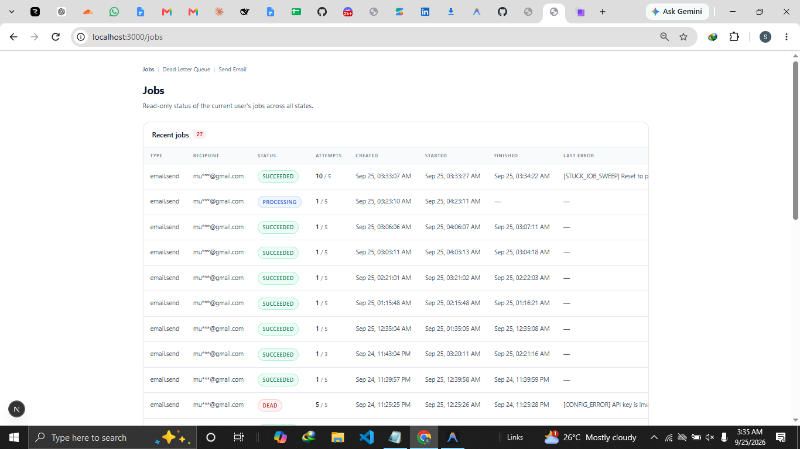

# DOCUMENTATION — Titife Background Job Processing System (v1)

Assessment documentation. Describes behavior implemented in this repository. Reference docs: `docs/PRD_Background_Job_Processing_Email_v2.md` (requirements) and `AGENTS.md` (engineering rules). Setup: `README.md`.

---

## 1. Project Overview

Email sending is moved off the HTTP request path. A client enqueues a job and gets `202` immediately; a standalone Node worker performs the send via Resend asynchronously.

v1 guarantees:
- The enqueue API never calls Resend inline.
- Every job ends `succeeded` or `dead` (visible, manually retryable) — nothing is silently lost.
- No two workers can process the same job (atomic claim).
- Retries never deliver the same email twice (idempotency at DB, handler, and provider).
- Every status transition is audited via append-only `JobEvent`.
- A stuck-job sweeper recovers jobs stranded in `processing`.

All config is environment-driven (`.env.example`); no hardcoded timings or secrets in code.

---

## 2. Scope

**Included:** one job type (`email.send`); four endpoints (`POST /api/jobs`, `GET /api/jobs/:id`, `GET /api/jobs?status=dead`, `POST /api/jobs/:id/retry`); one worker process (atomic claim, per-process concurrency cap, backoff+jitter, idempotent send, stuck-job sweep); `/jobs`, `/create`, `/dead-letters` pages; 30-day cleanup (`scripts/cleanup.ts`).

**Excluded:** other job types/registries; more than one worker instance; admin roles, cross-user visibility, notifications, spend caps; a `failed` status or separate retry scheduler (retryable → `processing → pending`, exhausted → `processing → dead`); full auth (userId comes from a header/token via `src/lib/auth.ts`, no login UI).

---

## 3. Architecture and Main Components

| Component | Location | Responsibility |
| --- | --- | --- |
| Enqueue API | `src/app/api/jobs/route.ts` → `enqueueJob` (`src/lib/jobs/enqueue.ts`) | Validate `email.send`, enforce `(userId, idempotencyKey)` uniqueness, insert `pending`, return `202`. |
| Status/dead-letter API | `src/app/api/jobs/[id]/route.ts`, `src/app/api/jobs/route.ts` (GET), `src/app/api/jobs/[id]/retry/route.ts` | Read status (userId-scoped, `404` otherwise), list dead, requeue dead. |
| Identity | `src/lib/auth.ts` → `resolveUserIdFromHeaders` | Only place userId is derived (Bearer, `x-user-id`, dev fallback). |
| Worker | `worker/index.ts` | Poll loop, concurrency cap, sweep interval, graceful shutdown. Only importer of Resend client. |
| Atomic claim | `worker/claim.ts` → `claimNextJob` | `UPDATE … WHERE id = (SELECT … FOR UPDATE SKIP LOCKED … LIMIT 1) RETURNING *` via `prisma.$queryRaw`. |
| Stuck-job sweep | `worker/sweep.ts` → `sweepStuckJobs` | Resets `processing` jobs past `STUCK_JOB_TIMEOUT_MS` to `pending`. |
| Handler | `worker/handlers/emailSend.ts` → `handleEmailSend` | Idempotency guard, Resend call, output write, transitions. |
| Resend client | `worker/resendClient.ts` → `sendEmailViaResend` | SDK wrapper, request timeout, `Idempotency-Key: jobId` header. |
| Backoff | `src/lib/jobs/backoff.ts` → `calculateBackoffMs` | Exact backoff + 20% jitter formula. |
| DB | `prisma/schema.prisma` | `Job`, `JobOutput`, `JobEvent`; 4-value `JobStatus`; cascade deletes; indexes. |
| Cleanup | `scripts/cleanup.ts` | Deletes `Job` rows > 30 days (cascades outputs/events). |

Flow: `POST /api/jobs` → `Job(pending)` → claim → `Job(processing)` → idempotency guard → Resend (`Idempotency-Key`) → success (`JobOutput` + `succeeded`) / retryable (`pending`, `runAt`=backoff) / exhausted (`dead`) / sweep reset (`pending`).

---

## 4. Job Lifecycle and Status Transitions

Enum has exactly four values (`prisma/schema.prisma`):

```
pending → processing → succeeded
              ├→ pending   (retryable failure, or sweep reset)
              └→ dead      (attempts exhausted, or immediate 400/422/401/403)
```

- **pending** — inserted by enqueue with `runAt = now()`; claimable when `runAt <= now()`.
- **processing** — set only by the atomic claim (`worker/claim.ts`), which also sets `startedAt` and increments `attempts`; `pending → processing` `JobEvent` written (`worker/index.ts:45-52`).
- **succeeded** — terminal, after send + `JobOutput` write, `finishedAt` set (`emailSend.ts:68-84`).
- **dead** — terminal, from `processing` on exhausted retries (`emailSend.ts:129-147`) or non-retryable 400/422/401/403 (`emailSend.ts:100-124`).

Every transition writes a `JobEvent` (`fromStatus`, `toStatus`, `message`, optional `actingUserId`). Append-only; never updated/deleted except via 30-day cascade.

---

## 5. Enqueue and Idempotency

`POST /api/jobs` (`route.ts:7-52`) → `enqueueJob` (`enqueue.ts:12-67`):
1. Type must be exactly `email.send`, else `400`.
2. `idempotencyKey` required (non-empty).
3. Payload needs `to`, `subject`, and `html` or `text`.
4. `maxAttempts` from `MAX_ATTEMPTS` env.
5. userId resolved via `getAuthenticatedUser` (`src/lib/auth.ts`) — never from the request body.
6. Insert `pending` row, return `202` `{ id, status, idempotencyKey, createdAt, duplicate }`. **No Resend call, no blocking work.**

**DB-level idempotency:** `@@unique([userId, idempotencyKey])`. A duplicate insert throws Prisma `P2002`, which `enqueueJob` catches and returns the existing job with `duplicate: true` (`enqueue.ts:46-65`) — enforced by the schema, not just app code.

Identity (`src/lib/auth.ts`): Bearer token → `x-user-id` header → dev-only fallback `dev_user_default`. All routes/pages go through this, scoping visibility to one user.

---

## 6. Worker, Atomic Claiming, and Concurrency

**Poll loop** (`worker/index.ts`): reads/validates `WORKER_CONCURRENCY`, `POLL_INTERVAL_MS`, `SWEEP_INTERVAL_MS` at startup (`index.ts:10-16`). `pollLoop` (`index.ts:26-74`) claims one job per iteration while in-flight count < cap (`index.ts:32-38`), processes it in a fire-and-forget task that decrements the counter in `finally` (`index.ts:42-64`). Cap reached → stops claiming until a slot frees. Reschedules via `setTimeout(pollLoop, pollIntervalMs)`.

**Atomic claim** (`worker/claim.ts:8-27`):

```sql
UPDATE "Job"
SET status = 'processing', "startedAt" = now(), attempts = attempts + 1
WHERE id = (SELECT id FROM "Job"
            WHERE status = 'pending' AND "runAt" <= now()
            ORDER BY "runAt" ASC
            FOR UPDATE SKIP LOCKED
            LIMIT 1)
RETURNING *;
```

Single statement via `prisma.$queryRaw`. `FOR UPDATE` locks the chosen row; `SKIP LOCKED` skips rows another transaction holds. The outer `UPDATE … RETURNING *` returns exactly one row to one caller, so two workers cannot take the same row (one gets it, the other gets nothing/different row). `attempts` increments at claim time → `maxAttempts = 5` = five total tries.

v1 constraint (AGENTS §3 rule 13): exactly one worker instance; `WORKER_CONCURRENCY` is per-process, not global.

---

## 7. Retry, Exponential Backoff, and Jitter

`calculateBackoffMs` (`backoff.ts:8-25`):

```ts
const exponentialDelay = Math.min(capMs, baseMs * Math.pow(2, attempts)); // cap 30000, base 2000
const jitter = Math.random() * (exponentialDelay * 0.2);                  // up to 20%
return Math.floor(exponentialDelay + jitter);
```

i.e. `min(30000, 2000 * 2^attempts) + random(0, backoff*0.2)` ms.

**Why jitter:** without it, failures in a mass outage reschedule every retry for the same instant — a synchronized thundering herd that re-triggers rate limiting. The spread staggers retries. Applied in `handleEmailSend` (`emailSend.ts:148-171`), which sets `runAt = now + backoffMs` and moves `processing → pending`.

Classification (`emailSend.ts`):

| Outcome | Handling | Ref |
| --- | --- | --- |
| Timeout / 429 / 5xx, attempts < max | → `pending`, `runAt`=backoff, `lastError` set | `emailSend.ts:148-171` |
| Same, attempts ≥ max | → `dead`, `finishedAt` set | `emailSend.ts:129-147` |
| 400 / 422 | → `dead` immediately, `attempts = maxAttempts` | `emailSend.ts:92-123` |
| 401 / 403 | → `dead` immediately, logged `[CONFIG_ERROR]` | `emailSend.ts:96-123` |

---

## 8. Idempotent Work and Crash Safety

Three mechanisms prevent double-send (PRD FR7, AGENTS §3 rules 5–6):

1. **Handler guard before send** — `handleEmailSend` checks for an existing `JobOutput` first (`emailSend.ts:9-12`). If present, it skips Resend and marks the job `succeeded` with event "Skipped Resend call; output already exists (FR7 Idempotency Guard)" (`emailSend.ts:13-33`).
2. **Provider idempotency** — every call (including retries) sends the job id as `Idempotency-Key` header (`resendClient.ts:73-76`). Covers the window where Resend accepted the send but the worker died before writing output.
3. **Unique-constraint race** — `JobOutput.jobId` is `@unique`. A second output write throws `P2002`, caught and treated as a success no-op (`emailSend.ts:53-65`).

**Crash-after-send:** worker dies post-accept/pre-mark-done → job stays `processing` → sweep (§9) resets to `pending` → worker reclaims → handler re-runs → mechanisms 1–3 ensure the recipient is emailed at most once.

---

## 9. Stuck-Job Detection and Recovery

`sweepStuckJobs` (`worker/sweep.ts`):
1. `cutoff = now - STUCK_JOB_TIMEOUT_MS` (default 5 min) (`sweep.ts:9-13`).
2. Finds `status = processing AND startedAt < cutoff` (`sweep.ts:15-22`); `startedAt` is set by the claim, so it measures real processing time.
3. Per stuck job, in a transaction (`sweep.ts:31-52`): reset → `pending`, increment `attempts`, set `runAt = now()` and `lastError = "[STUCK_JOB_SWEEP] Reset to pending after timeout exceeding {ms}ms"`, write `processing → pending` `JobEvent`.

Scheduled on `setInterval` of `SWEEP_INTERVAL_MS` (default 60s), separate from the poll loop (`worker/index.ts:77-84`). After reset, the normal claim query picks the job back up.

---

## 10. Dead-Letter Handling

- **List** — `GET /api/jobs?status=dead` (`route.ts:54-88`): calling user's dead jobs only (payload, lastError, attempts).
- **UI** — `/dead-letters` (`src/app/dead-letters/page.tsx`; components in `src/components/`).
- **Retry** — `POST /api/jobs/:id/retry` (`[id]/retry/route.ts:6-66`): resolves userId; `404` if missing or another user's job; `400` unless `dead`; in a transaction sets `pending`, `attempts = 0`, `runAt = now()`, clears `lastError`, writes `JobEvent` with acting userId.
- **Status** — `GET /api/jobs/:id`: id, status, attempts, maxAttempts, lastError, timestamps; `404` for other users' jobs.

---

## 11. Testing and Evidence

> Caveat: the PNG contents were not re-rendered for this document; each description is based on its filename and the controlled test run that produced it. Verify each screenshot visually before quoting it.

### Evidence 1 — Enqueue → pending (FR1)



Proves `FR1`: a job row is created and shown in `pending` on the `/jobs` page immediately after enqueue, before the worker claims it.

### Evidence 2 — First claim → processing (FR2/FR4)



Proves `FR2`/`FR4`: after the worker claims a job, it shows `processing` (captured during a deliberate temporary 60-second processing hold for evidence).

### Evidence 3 — Successful send → succeeded (FR4)



Proves `FR4`: a job reaches `succeeded`, with attempts and timestamps visible on `/jobs`.

### Evidence 4 — Retry backoff growing (FR6)



Proves `FR6`: retry scheduling shows growing delays between attempts (exponential backoff).

### Evidence 5 — Concurrency cap (FR3)



Proves `FR3`: 50 queued jobs are processed with at most `WORKER_CONCURRENCY` (5) in flight.

### Evidence 6 — Stuck job, before recovery (FR8 precondition)



Proves the `FR8` precondition: a job is left in `processing` (worker stopped/crashed).

### Evidence 7 — Dead-letter view (FR9)



Proves `FR9`: the dead-letter UI lists dead jobs with error detail and a retry action.

### Evidence 8 — Stuck job, after recovery (FR8/FR9)



Proves `FR8`/`FR9`: the stuck job returns to a non-`processing` state after worker restart / manual retry.

**Gaps — implemented but not demonstrably evidenced:**

- `FR8` sweep event firing: the in-session attempt exposed a clock-skew defect (raw-SQL `startedAt` from `claim.ts` vs JS clock in `sweep.ts`), so no `[STUCK_JOB_SWEEP]` event was captured. `06/08` show states, not the sweep firing.
- `FR11` audit trail: no screenshot of `JobEvent` rows.
- `FR1` duplicate key: no screenshot of `duplicate: true` returning the existing job.
- `FR7` no screenshot of the output guard skip or `Idempotency-Key` header.
- No evidence linking dead jobs to the `400/422/401/403` immediate-dead path.
- `FR10`: no evidence of the userId-scoped `404`.

---

## 12. Defence Questions and Answers

### Q1. Two workers are running. How do you guarantee they never process the same job?

**A.** The claim is a single atomic statement, never read-then-write. `claimNextJob` (`worker/claim.ts:8-27`) runs one `UPDATE … WHERE id = (SELECT … FOR UPDATE SKIP LOCKED … LIMIT 1) RETURNING *` via `prisma.$queryRaw`. The inner `SELECT` locks the chosen row (`FOR UPDATE`) and skips rows another transaction already holds (`SKIP LOCKED`); the outer `UPDATE` sets `processing`, `startedAt`, increments `attempts`, and `RETURNING *` hands the row to exactly one caller. A second worker cannot take the row the first holds; with one eligible job only one worker ever holds it. Claims only select `status = 'pending'`, so `processing` is the exclusion criterion.

- Locate: `worker/claim.ts:8-27`, invoked at `worker/index.ts:32`; claimer writes the `pending → processing` `JobEvent` (`worker/index.ts:45-52`).

### Q2. The worker crashes after sending the email but before marking the job done. What happens on restart?

**A.** Safe by three idempotency layers plus the sweep:
1. Job stays `processing`; the sweep (`worker/sweep.ts` → `sweepStuckJobs`, `sweep.ts:31-52`) resets it to `pending` once `startedAt` exceeds `STUCK_JOB_TIMEOUT_MS`, and it is re-claimed normally.
2. Before re-calling Resend, `handleEmailSend` checks for an existing `JobOutput` (`emailSend.ts:9-12`). If output exists (crash after write, before status update), it skips Resend and marks `succeeded` (`emailSend.ts:13-33`).
3. If the crash was after Resend accepted but before output write, the re-run calls Resend again — but every call sends the job id as `Idempotency-Key` (`resendClient.ts:73-76`), so Resend de-duplicates. A raced `JobOutput` write hits the `@unique` constraint (`P2002`) and is caught as a success no-op (`emailSend.ts:53-65`).

Net: the recipient is emailed at most once; the job still reaches `succeeded`.
- Locate: `emailSend.ts:9-12/13-33/53-65`, `resendClient.ts:73-76`, `sweep.ts`, `worker/index.ts:77-84`.

### Q3. Why is jitter used? Show the actual formula.

**A.** Plain exponential backoff reschedules every job that failed in an outage for the same instant — a synchronized thundering herd that can re-trigger the rate limiting that caused the failures. Jitter (0–20% of the delay, random) staggers retries across a small window.

Formula — `calculateBackoffMs` (`backoff.ts:8-25`):

```ts
Math.min(capMs, baseMs * Math.pow(2, attempts))          // min(30000, 2000*2^attempts)
+ Math.random() * (exponentialDelay * 0.2)               // random(0, backoff*0.2)
```

Result becomes `runAt` on retryable failure (`emailSend.ts:150-160`).

### Q4. A job has been in `processing` for an hour. What happens, and when?

**A.** Not an hour — the sweep handles it in ~6 minutes under defaults. Default `STUCK_JOB_TIMEOUT_MS` = 300000 ms (5 min); sweep runs every `SWEEP_INTERVAL_MS` = 60000 ms (1 min). The sweep finds `status = processing AND startedAt < now - timeout` (`sweep.ts:13-22`) and per job resets to `pending`, increments `attempts`, sets `runAt = now()` and `lastError` `[STUCK_JOB_SWEEP] …`, and writes the audit event (`sweep.ts:31-52`). Then the normal claim queue picks it up again. The sweep is an independent `setInterval` (`worker/index.ts:77-84`), so it runs even while handlers are busy.
- Locate: `worker/sweep.ts:8-57`, scheduled at `worker/index.ts:77-84`; timings from env at `worker/index.ts:10-16`.

---

*End. Describes the implementation as built and points to the exact code for each claim.*